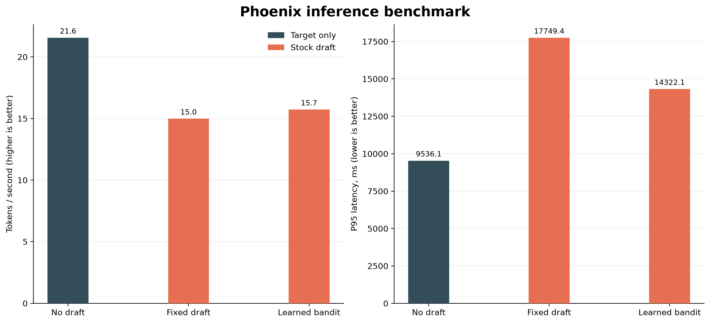
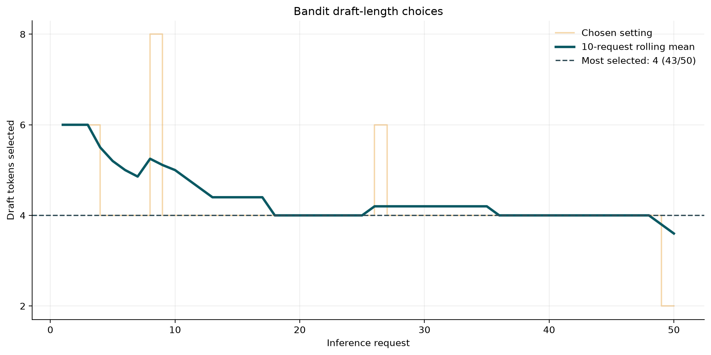

# Phoenix

Phoenix is an experimental LLM inference server combining speculative decoding
with an online bandit that chooses how many tokens the draft model should
propose.

The current benchmark uses Qwen3-0.6B as the stock draft model and Qwen3-1.7B
as the target. The target remains authoritative: drafted tokens are accepted
only when verified by the target model.


## Current benchmark

Fifty requests were run per mode, with up to 200 new tokens per request.

| Mode | Tokens/sec | P95 latency | Acceptance |
| --- | ---: | ---: | ---: |
| Target only | 21.55 | 9.54 s | N/A |
| Fixed, 4 draft tokens | 14.98 | 17.75 s | 69.97% |
| Learned bandit | 15.72 | 14.32 s | 68.95% |

The learned scheduler raises throughput by 4.9% and lowers p95 latency by 19.3%
relative to fixed-four speculation. This stock-draft run does not yet beat
target-only decoding; fine-tuned-draft measurements are still pending.



The bandit selected four draft tokens on 43 of 50 requests. The last two
requests explored two tokens, so a longer run is needed before claiming full
convergence.



See [the complete analysis](docs/BENCHMARK_ANALYSIS.md) for caveats and missing
metadata.

## Reproduce the prompt split

The preparation script reads the public, ungated
[`Tapos-Minmoy/python_programming_questions`](https://huggingface.co/datasets/Tapos-Minmoy/python_programming_questions)
dataset. It deduplicates questions, shuffles with seed 42, and writes disjoint
500/50 train/test splits.

```bash
python3 prepare_prompts.py
```

## Reproduce the charts

```bash
python3 -m venv .venv
.venv/bin/python -m pip install -r requirements.txt
.venv/bin/python scripts/plot_results.py
```

Inputs are `results.json` and `bandit_log.csv`; generated images are written to
`charts/`.

## Submission material

- [Benchmark analysis](docs/BENCHMARK_ANALYSIS.md)
- [Sentry dashboard setup](docs/SENTRY_DASHBOARD.md)
- [Devpost draft](docs/DEVPOST.md)
- [Two-minute demo script](docs/DEMO_SCRIPT.md)
